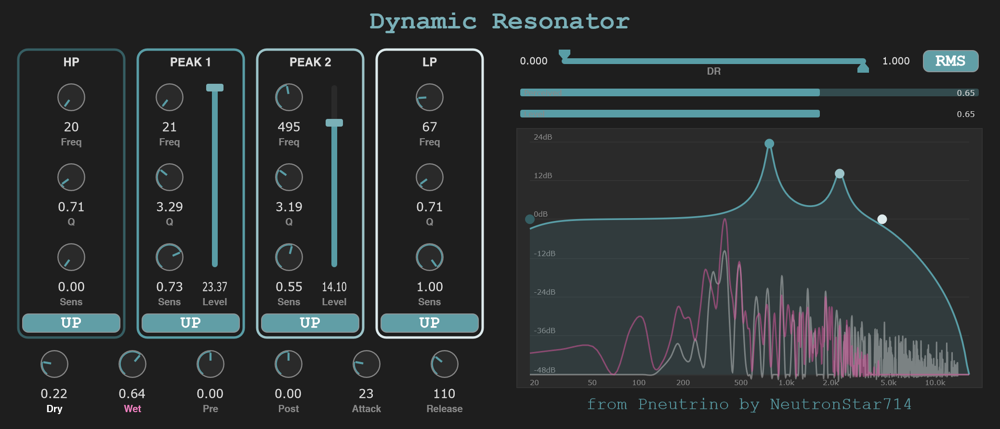

# Dynamic Resonator

An four-band equalizer with input-responsive frequency control for live guitar playing, sound design and music production, from **the Pneutrino series by independent music producer and G10's lead guitarist NeutronStar714**. Inspired by the BOSS FT-2 dynamic filter pedal's auto-wah behavior, it extends amplitude-driven frequency movement to a 4-band EQ: high-pass, two peaking EQ bands and a low-pass. Each band has independent frequency, resonance (Q), sensitivity and Up/Down sweep controls.

**Start here:** [How it was made](docs/PROCESS.md) · [Complete project source](Source) · [Build instructions](BUILDING.md) · [Contributions and AI assistance](docs/CONTRIBUTIONS.md)

## Demonstration status

Guitar audio demo by NeutronStar714, recorded for the Pneutrino plugin showcase (38 seconds).

[▶ Listen / download the audio demo](https://raw.githubusercontent.com/NeutronStar714/pneutrino-dynamic-resonator/main/assets/pr-rec-dynres.mp3)

GitHub does not render audio controls inside a README; the link provides the playable MP3 file.

[Download Standalone](https://github.com/NeutronStar714/pneutrino-dynamic-resonator/releases/download/v1.3.0/DynamicResonator-1.3.0-Windows-x64-Standalone.zip) · [Download VST3](https://github.com/NeutronStar714/pneutrino-dynamic-resonator/releases/download/v1.3.0/DynamicResonator-1.3.0-Windows-x64-VST3.zip) · [Release notes and checksums](https://github.com/NeutronStar714/pneutrino-dynamic-resonator/releases/tag/v1.3.0)

Windows x64, version **1.3.0**. Extract the standalone ZIP to run it, or install the complete VST3 bundle in your DAW's plugin folder. The screen-recorded walkthrough is still in preparation.

## Implemented in the recovered source

- Four stereo biquad bands with independent amplitude-driven frequency modulation.
- RMS/AM detection, attack/release, a selectable input-loudness window, dry/wet and pre/post gain.
- Live spectra, filter response, raw detector and modulation-envelope meters.
- Parameter-state save/restore; VST3 and standalone build targets.

Version **1.3.0** is the existing project declaration. [Testing and limitations](docs/TESTING.md) separates historical user reports from checks performed for this source import.

## Development record

The [development process](docs/evidence/README.md) includes a summary and all recovered project records: 114 prompts, 10 commands, 36 saved UI-file revisions and 35 build records. The main development ran from July 27 to August 2, 2026. [CHANGELOG.md](CHANGELOG.md) labels its historical entries as reconstructed. No original project Git history was recovered; version control began with the source import.

## Source and dependencies

All four project-owned C++ files and the CMake build configuration are included. JUCE is referenced as an upstream submodule at an exact commit; use the recursive clone instructions in [BUILDING.md](BUILDING.md). Compiled binaries and intermediate build products are excluded. The recovered development records include the full surviving project prompt log, with personal directory paths redacted.

The repository's existing [MIT license](LICENSE) is retained for project-owned material. JUCE and its bundled dependencies retain their own terms; see [third-party notices](THIRD_PARTY_NOTICES.md).
